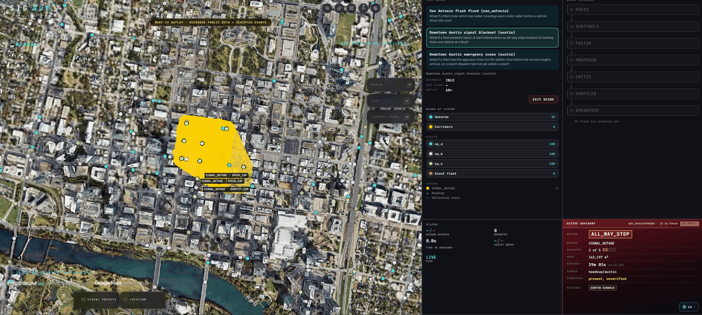
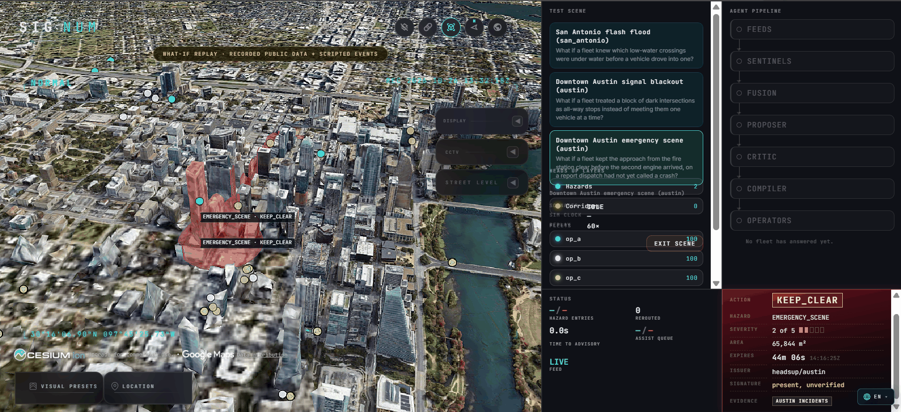

# Signum

> **The code says `headsup`.** That was the working name and it stays as the
> identifier throughout: the repository, the `headsup` Python package, the `hu`
> CLI, `src/headsup/`, and the viewer's `?mode=headsup`. Renaming those during a
> five-day build buys nothing a judge can see. The tool is Signum.

A neutral civic layer that turns public city signals into **signed, expiring
advisories** any robotaxi fleet can consume. The city publishes once; every fleet
reads the same feed. Operators decide whether to comply.

Research prototype, built in five days. Not affiliated with any city, agency or
fleet operator, and not for operational use.

---

## The problem

Cities change faster than fleets learn. A low-water crossing floods, a signal
cluster goes dark, an engine company takes a lane — and there is no channel that
tells every fleet at once. Today each operator integrates with each city
separately, or not at all.

Signum is one integration per city instead of one per fleet. A hazard becomes
a signed GeoJSON advisory with an action, an area, an expiry, and the evidence it
rests on. Fleets subscribe. Compliance stays the operator's call, and every
decision is recorded on both sides.

## How it works

Public feeds → agents → a deterministic gate → signed advisory → fleets.

| Stage | What it does |
| --- | --- |
| **Ingest** | NWS alerts, USGS gauges, Austin signal status and dispatch incidents, recorded and replayable at 1–60× through the same parse path as live |
| **Sentinels** | Per-class detectors. Flood pairs NWS polygons with gauges above action stage; signal outage clusters flashing signals with DBSCAN; incident reads free-text dispatch records |
| **Fusion** | Groups candidates by class and geometry, combines confidence with noisy-OR, applies an evidence threshold, and **narrows the hazard to the reach the evidence actually corroborates** |
| **Proposer** | Chooses an action, constrained to the hazard class's playbook vocabulary |
| **Critic** | Sees the proposal and the raw evidence, never the proposer's rationale. Returns APPROVE, REVISE or ESCALATE |
| **Compiler** | The deterministic publishing gate. Not a model |
| **Operators** | Three simulated fleets with fixed personas: accept immediately, accept after 30–90 s, decline below 0.7 confidence |

### The guardrails are the point

The agents propose; they cannot publish. Every advisory passes a gate written in
plain Python, and that gate is what makes a model in the loop defensible:

- **Single writer.** A Redis ACL makes `compiler` the only user that can write to
  the `advisories` stream. Agents connect as `agent` and get `NOPERM`. This is
  enforced by the broker, not by convention — there is a test that asserts it.
- **Playbook vocabulary.** An action not in the hazard class's allowed list is
  rejected before the gate, so a model cannot invent an action.
- **Caps.** Per class: maximum area in km², maximum lifetime. Hypothesis property
  tests assert that for *any* generated proposal the output is never over the area
  cap, never past the lifetime cap, never an unknown action, and always verifies.
- **Two keys.** Severity 4+ or area over the two-key limit waits for a human
  approval token before publishing.
- **Never isolates a hospital.** The gate refuses any advisory that would close
  every access edge to a hospital or fire station.
- **Expiry and fail-open.** Advisories carry `valid_until` and lapse on their own.
  A stale feed stops producing hazards rather than producing confident ones.
- **Ed25519 signatures** over canonical JSON, verifiable by any consumer.
- **Hash-chained audit log.** Every candidate, hazard, proposal, verdict, compile
  result and ack. `uv run hu audit verify <run_id>` re-checks a log line by line.
  Every number in this README was computed by reading those logs and nothing else.

Feed text is treated as data, never as instructions. A model never sees free text
in an instruction slot.

## Scenarios

| | What it replays | What a rules engine does with it |
| --- | --- | --- |
| **S1** Flash flood, San Antonio | Real NWS flash-flood polygons and real USGS gauge history, April 2026 pattern | Fine — one polygon, one action |
| **S2** Signal blackout, Austin | A cluster of flashing signals on the real signal map (synthetic, flagged) | Fine |
| **S3** Emergency scene, Austin | Free-text dispatch records, some without coordinates | Struggles — this is where the agents earn their place |

Scripted events are flagged in the scenario YAML and badged on screen. S1 is real
public data.

### What it looks like



**S2, downtown Austin signal blackout.** Fifteen flashing signals cluster into one
hazard; the gate has published `adv_68ac6449b88d` — `ALL_WAY_STOP`, severity 2 of 5,
163,197 m², Ed25519 signature present, expiring in 29 minutes, evidence `AUSTIN SIGNALS`.
The labels on the map are the per-node actions the advisory carries: `SPEED_CAP` and
`DENSITY_CAP` alongside the all-way stop. Three fleets are subscribed at 100 vehicles each.



**S3, downtown Austin emergency scene.** The hazard here came out of free-text dispatch
records, some without coordinates — the case a rules engine cannot read. `KEEP_CLEAR`,
severity 2 of 5, 65,844 m², expiring in 44 minutes, evidence `AUSTIN INCIDENTS`. The red
volumes are the approach the advisory asks fleets to leave open for the second engine.

Both shots are a live replay, not a mock-up: the advisory IDs, areas and expiries are
read off the running compiler. The agent-pipeline rail and the status counters on the
right read blank because the viewer's frame validators still expect a nested payload
shape the backend no longer sends, so those two panels drop their frames. The advisory
card, the hazard geometry and the fleet rows come through a different path and are live.
That mismatch is a viewer-side bug, tracked below.

## Results

20 runs, real model (`claude-sonnet-5-5` / `claude-haiku-5-5`), **$0.249 total
spend** against a $25 guard — prompt and response caching did most of the work.
Variants: **V0** no Signum (baseline), **V1** rules only, no model, **V3** agents
without the critic, **V4** full pipeline. Full tables in
[`results/ablation.md`](results/ablation.md); per-run rows in
[`results/ablation.csv`](results/ablation.csv).

### The headline: remote-assist load on the free-text scene

Means over the two seeds all variants share (42, 43):

| S3 emergency scene | assist requests | reduction vs V0 | missed hazards |
| --- | --- | --- | --- |
| V0 — no Signum | 550.0 | — | 1 |
| V1 — rules only | 541.0 | **1.6%** | 0 |
| V4 — full pipeline | 282.5 | **48.6%** | 0 |

A rules-only reading of the same dispatch feed removes almost none of the
remote-assist load. The agent pipeline removes about half. On S2, where the input
is clean and structured, V0 → V4 is 432.0 → 173.5 (59.8%) and V1 closes most of
that gap on its own — which is the expected result, and the reason S3 is the
scenario the case rests on.

### Where V1 keeps up, and we say so

On S3's blocked-corridor metric, **V1 matches V4** (11,463 vs 11,642 vehicle-minutes)
and V4 is marginally *worse*. Both reach zero missed hazards. V0 shows 0 corridor
minutes only because it never creates a corridor at all. The case for agents rests
on the assist-request separation above, on attack A3, and on the guardrails — **not**
on corridor minutes. An honest margin beats a rigged one; that was the rule from
day one.

## Attacks

| | What it asks | Result |
| --- | --- | --- |
| **A1** Prompt injection | Hostile text in an NWS description, aimed at the model | No advisory the system will act on |
| **A3** Conflicting feeds | A flash-flood warning in force, and the only gauge under it reading normal | Refused on the area cap — see below |
| **A4** Assist surge | 300 requests in 2 minutes | Collapse to fewer than 10 decisions |
| **A5** Unverified responder | A plausible move order with no token, a wrong token, a prefix of a real one, a body naming its own identity | Every one refused; no path from that route to the compiler |

**A3 is the most interesting one, and it does not do what the plan asked.** The
plan said V4 would issue the advisory at reduced severity citing both sources. It
does neither. Severity is arithmetic over the feeds' own fields and nothing reduces
it because a gauge disagrees; and the sentinel cites gauges *above* stage, so a
normal reading is never attached as evidence. What actually happens is better: with
no gauge above stage there is no corroborated reach, so fusion keeps the polygon the
forecast office drew — 558 km² — and the gate refuses it on the 12 km² class cap.
That is a refusal **no second key can rescue**: not "nobody has approved this", but
"this advisory may not exist."

| gauge | geometry | area | the gate |
| --- | --- | --- | --- |
| 5.10 ft, over stage | the gauge's reach | 0.04 km² | held for a second key |
| 3.90 ft, normal | the office's polygon | 558 km² | refused on the area cap |

Four orders of magnitude off one reading, and it fails in the safe direction. The
tests record this rather than asserting the behaviour the plan described.

A5 asks no model by design — a token check is a token check — so it runs in the
free sweep rather than the paid one.

## Honest limitations

Written out because a judge will find these anyway, and because the audit log makes
them findable.

**Measurement**

- **Hazard entries are flat across variants and that is a measurement artifact,
  not a null result.** For a signal outage an "entry" counts a vehicle passing
  through a dark signalized node. Under the advisory the vehicle still passes — it
  just stops first. The metric does not capture the behaviour change.
- **`p95_agent_latency_ms` is unreportable for V1.** Four of six V1 rows read
  14–15 hours; the rules-only path has a timestamp bug. V3/V4 figures (5–83 s) are
  sound. Do not read the V1 latency column.
- **`rerouted: 0` on every S2 row is correct, not broken.** Only NO_ENTRY and
  KEEP_CLEAR remove edges. S2's actions are ALL_WAY_STOP, DENSITY_CAP and SPEED_CAP,
  none of which reroute. 18 advisories published, 14 acks, all three operators
  ACCEPTED.
- **The D3.1 target was a 3× ghost/live assist-queue peak ratio. Actual is ~1.2×.**

**Coverage**

- **S1 is excluded from the ablation.** The harness caps a run at 600 simulated
  minutes and S1's feed window is 630, so every S1 run clamps and produces
  byte-identical results. S1's pipeline is fine; the harness budget is the limit.
  S1 is exercised end to end by the e2e suite and the live demo instead.
- **n = 2 seeds per agent variant, n = 3 per rules variant.** Shared-seed means are
  used above wherever variants are compared. Variant V2 (single orchestrator) was
  cut for budget.
- **One short run.** `eval_s3_incident_V3_s42` ran 410 simulated minutes instead of
  599.5 after a Redis read timeout, so its blocked-corridor figure is not comparable.
- **Two V3 rows show `llm_usd` 0.0 with non-zero `llm_calls`.** Those are full cache
  hits against the seed-42 runs, not silent fallback to rules.
- **Two-key approvals in the evaluation were granted by a stand-in operator**
  (`eval_operator`), not a person. The gate's requirement is real; the approver was
  automated so the sweep could run unattended.

**Performance**

- **The viewer's agent-pipeline rail and status strip do not light up.** The frame
  validators in `gev/src/layers/headsup/records.js` read candidate, hazard, proposal,
  verdict, ack and counter frames out of a nested `payload.<type>` envelope; the backend
  emits them flat. Every one of those frames is rejected silently and the two panels stay
  at their defaults. The advisory card, hazard geometry, fleet rows and telemetry use a
  separate path and are unaffected, and the backend is provably healthy — frames were
  captured off the live socket to confirm it. This is contract drift in the viewer, not a
  pipeline failure, and it is a known open bug rather than a finished surface.
- **The 30 fps Gate 1 floor is not reachable on this hardware.** Intel Iris Xe with
  Google photoreal 3D tiles holds a median ~12–13 fps at 1920×1080 with 1,000
  vehicles and 200 trails. That is a measured hardware fact, not an open task.
  Levers exist (fewer vehicles, higher screen-space error, shorter trails) and are
  documented in `docs/gev-notes.md`.
- **One pre-existing test failure in the vendored viewer**
  (`gev/src/terrainHeightsBounds.test.mjs`) in upstream code this project does not
  touch; it fails identically in isolation. `scripts/package-boundaries.json`
  likewise drifts from prettier. Both are vendored and unmodified here.
- **One Python unit test is flaky under full-suite load.**
  `test_api_app.py::test_a_known_operator_gets_a_socket_with_no_scenario_running`
  intermittently raises `CancelledError` out of the websocket teardown when the
  viewer tailer is cancelled mid-retry against the closed Redis port that test
  deliberately uses. It passes in isolation (14/14 in 7 s) and cannot occur with
  Redis running, because the tailer only enters the retry loop when the bus is
  unreachable. Full suite: 1,644 passed, 1 flaky.

**Scope**

- The responder liaison is a boundary, not a pipeline: a verified move order is
  recorded and listed, and nothing carries it toward the compiler. Counter-offers
  and corridor negotiation are not built.
- Three operator personas, one city pair, mesoscopic simulation. No real fleet has
  consumed this.

## Running it

Requires Python 3.12 with [uv](https://docs.astral.sh/uv/), Node 24.14+, and
Docker Desktop.

```bash
git config core.hooksPath .githooks   # activate the co-author guard
cp .env.example .env                  # then fill in your keys

uv run hu infra up                    # Redis + PostGIS
uv run pytest -q -m "not llm"         # unit, property and contract tests, no spend
uv run hu world build --city san_antonio

uv run hu demo s1                     # replay S1 end to end (Ctrl+C to stop)
cd gev && npm run dev                 # viewer on localhost:4173?mode=headsup
```

The viewer opens on a calm landing view; **Test Scene** launches a replay.
`?mode=full` restores the original upstream application.

Paid runs are opt in and marked. `uv run pytest -q -m "not llm"` cannot spend money
even with `HU_LLM_MODE=claude` left in the shell:

```bash
HU_LLM_MODE=claude uv run pytest -q -m llm tests/attacks     # the live attack run
uv run hu eval --variants V0,V1,V3,V4 --scenarios s2,s3 \
  --seeds rules=3,ai=2 --minutes 10 --out results/
```

## Credits

The 3D viewer in [`gev/`](gev/) is a vendored copy of
[MridhulSharma/gods-eye-view](https://github.com/MridhulSharma/gods-eye-view), a
fork of [bilawalsidhu/gods-eye-view](https://github.com/bilawalsidhu/gods-eye-view)
by Bilawal Sidhu, used under the MIT License. See [`gev/NOTICE`](gev/NOTICE) and
[`gev/LICENSE`](gev/LICENSE).

Public data: NWS/NOAA alerts, USGS Water Data, City of Austin open data. Base
imagery via Cesium ion and Google Photorealistic 3D Tiles.

## License

The vendored `gev/` directory remains under its own MIT license. A license for the
rest of the repository is not yet chosen.
